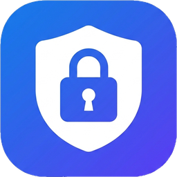

<div align="center">
  
  <h1>账号管家 (Account Vault)</h1>
  <p><strong>跨平台密码、OTP (TOTP/HOTP) 与 Passkey 通行密钥端到端加密保险库</strong></p>

  <p>
    <a href="https://tauri.app/"></a>
    <a href="https://www.rust-lang.org/"></a>
    <a href="https://vuejs.org/"></a>
    <a href="https://www.sqlite.org/"></a>
    
    <a href="LICENSE"></a>
  </p>

  <p>
    <strong>简体中文</strong> · <a href="README_EN.md">English</a>
  </p>
</div>

---

**Account Vault（账号管家）** 是一款支持 **Windows 桌面端、Android 移动端（Android 16+）与 Chrome / Edge 浏览器扩展** 的现代化全平台凭据管理工具。基于 **Rust + Tauri 2.0 + Vue 3 + SQLite3** 原生构建，所有账号数据与本地配置均通过 **AES-256-GCM + Scrypt** 加密存储，支持 **WebDAV 零知识云端增量同步**、**系统级自动填充 / Passkey 接管** 与 **多账号隔离沙箱浏览器**。

---

## ✨ 核心功能特性

### 1. 🗄️ SQLite3 全加密本地存储引擎
- **逐记录 AES-256-GCM 加密**：本地采用 SQLite3（`vault.db`，开启 `WAL` 模式）存储，每条账号记录与敏感配置（WebDAV 凭据、扩展配对密钥、生物识别凭据）均使用独立随机 Nonce 加密落盘，主密码绝不落盘。
- **硬件级密钥保护**：Windows 端结合 **Win32 DPAPI (`CryptProtectData`)** 绑定当前系统用户安全上下文；Android 端结合 **Android Keystore (`AES/GCM/NoPadding`)** 硬件密钥库保护。
- **在线快照备份与回滚**：依托 `rusqlite::backup` 在数据变更前自动生成加密数据库快照（`backups/*.db`），支持历史版本一键回滚。
- **网站图标持久化缓存**：内置 `favicon_cache` 表，按域名自动拉取并缓存网站 Favicon，同域名多账号自动复用同一图标，离线与二次启动零延迟展示。

### 2. 🧭 液态玻璃三栏视图（OTP · 密码 · PassKey）
- **底部液态玻璃胶囊导航**：提供 **OTP**、**密码**、**PassKey** 三大核心视图，带有弹簧滑动切换动画，支持在设置中自定义默认启动页（默认进入 **OTP**），支持移动端列表下拉刷新。
- **OTP 验证器（TOTP + HOTP 双兼容）**：
  - 完整支持 **RFC 6238 (TOTP)** 30 秒实时动态口令与 **RFC 4226 (HOTP)** 计数器动态口令（支持一键 **「下一位 (+1)」** 递增持久化）；
  - 顶栏内置 **扫码** 按钮，支持摄像头实时扫码、上传图片或直接 `Ctrl+V` 粘贴截图识别 `otpauth://totp/` 与 `otpauth://hotp/`。
- **PassKey 通行密钥（WebAuthn / FIDO2 ES256）**：
  - 支持基于 **ECDSA P-256 (ES256)** 的通行密钥创建、CBOR `attestationObject` 构造与 ASN.1 DER 登录签名；
  - 通行密钥随账号记录一同通过 SQLite3 与 WebDAV 端到端加密跨端同步。

### 3. 🧩 Chrome / Edge 浏览器扩展（Manifest V3 双模式）
扩展位于 [`browser-extension/`](browser-extension)，支持在扩展设置中自由切换两种连接模式：
- **模式一：本地桌面端桥接（`127.0.0.1:47291`）**：
  - 通过随机配对密钥（Bearer Token）与桌面端安全通信，直接复用桌面端（含 Windows Hello）解锁状态，并校验请求 `Origin` 阻止网页 CSRF / DNS Rebinding。
- **模式二：WebDAV 云端直连（纯浏览器独立运行）**：
  - 无需开启桌面端，扩展内置与 Rust 逐字节一致的 `Scrypt (N=32768, r=8, p=1) + AES-256-GCM` 加解密引擎与 `Smart Merge` 算法；
  - 主密码仅保存在浏览器内存会话（`chrome.storage.session`）中，支持 `ETag / HEAD` 自动增量检测与后台定时同步。
- **网页自动填充、2FA 悬浮小窗与 PassKey 接管**：
  - 自动在登录框旁展示 AccountVault 图标角标，识别单框及 6 格拆分验证码输入框，并在同主域/子域下自动弹出 **2FA 悬浮小窗**（一键填入或复制）；
  - 代理 `navigator.credentials.create()` / `get()`，支持在扩展设置中选择 **「独立窗口弹窗」** 或 **「页面悬浮卡片（封闭 Shadow DOM）」** 两种 PassKey 弹窗样式，未匹配时透明回退系统原生 Windows Hello。

### 4. 📱 Android 16 系统级自动填充与通行密钥提供程序
- **系统通行密钥与密码提供程序（`CredentialProviderService`）**：可在系统“密码、通行密钥与自动填充”中设为首选服务，直接在第三方 App 与浏览器中创建或使用 PassKey 与密码。
- **系统自动填充服务（`AutofillService` + `InlinePresentation`）**：同时支持输入法候选栏内联胶囊填充与下拉菜单填充，内置主流浏览器 `<compatibility-package>` 兼容声明与 OTP 自动填入。

### 5. 🔄 多密码管理器导入 & 🌐 隔离沙箱浏览器
- **一键迁移导入**：支持导入 **Chrome、Edge、Firefox、Safari、Bitwarden、1Password、KeePass** 导出的 CSV / JSON 密码文件，以及 `.avault` / `.gvault` 加密备份包。
- **多账号隔离沙箱浏览器**：每个账号分配独立 WebView2 / Android WebView 会话目录与可选代理配置，自动识别并跳过注册页面，实现多账号防关联登录。

---

## 🔐 安全与加密规格一览

| 模块 | 加密算法 / 规范 | 说明 |
| :--- | :--- | :--- |
| **主密钥派生 (KDF)** | `Scrypt` (`N=32768, r=8, p=1, dkLen=32`) | 16 字节随机 Salt，抵御暴力破解 |
| **账号记录加密** | `AES-256-GCM` (`AAD="AccountVault:Record:1"`) | 每条记录独立 12 字节随机 Nonce 加密存入 SQLite3 |
| **本地配置加密** | `AES-256-GCM` + `Win32 DPAPI` / `Android Keystore` | WebDAV 凭据、扩展密钥等在 `app_settings` 表全密文存储 |
| **WebDAV 云同步信封** | `AES-256-GCM` (`AAD="AccountVault:1"`) | 云端仅存密文信封，基于 `ETag` 与时间戳执行 Smart Merge |
| **动态口令 (OTP)** | `RFC 6238 (TOTP)` & `RFC 4226 (HOTP)` | `HMAC-SHA1` 6 位动态口令 |
| **通行密钥 (Passkey)** | `WebAuthn Level 2` / `FIDO2` (`ES256` / `P-256`) | CBOR `attestationObject` + `COSE_Key` + `ASN.1 DER` 签名 |

---

## 📖 三端使用与配置指南

### 1. 浏览器扩展安装与配对（Chrome / Edge）
1. 打开 `chrome://extensions` 或 `edge://extensions`，开启右上角 **开发人员模式**。
2. 点击 **加载已解压的扩展程序** 选择 [`browser-extension`](browser-extension) 目录（或直接拖入打包好的 `AccountVault-Browser-Extension.crx`）。
3. 点击扩展弹窗右上角 `⚙` 选择连接模式：
   - **本地桌面桥接**：在桌面端 **设置 → 安全设置 → Chrome / Edge 浏览器扩展联动** 中点击 **复制密钥**，粘贴至扩展设置并保存；
   - **WebDAV 云端直连**：填写 WebDAV 地址、账号与应用密码，点击保存后输入主密码即可独立解锁并同步。

### 2. Android 端开启系统自动填充与 PassKey
1. 安装 APK 后，先打开 AccountVault 解锁一次保险库。
2. 进入应用 **设置 → 安全设置 → 去系统设置开启**（或前往手机 **系统设置 → 密码、通行密钥与自动填充**），将首选服务切换为 **AccountVault**。
3. **常见机型防抢占提示**：
   - **小米澎湃 OS / MIUI 等国产系统**：请在系统设置中搜索 **`安全键盘`** 并关闭「使用安全键盘」，同时关闭系统自带密码本的自动填充开关，否则系统安全键盘会屏蔽第三方自动填充服务。
   - **Chrome 浏览器（Android 14+）**：打开 Chrome **设置 → 自动填充服务**，选择 **「使用其他自动填充服务」** 并重启 Chrome。

### 3. 本地数据存储路径
- **Windows**：`%LOCALAPPDATA%\AccountVault\vault.db`（快照位于同目录 `backups\*.db`）
- **Android**：`/data/data/com.ifnor.accountvault/files/vault.db`（快照位于同目录 `backups/*.db`）

---

## 📂 项目目录结构

```text
AccountVault/
├── browser-extension/          # Chrome / Edge 浏览器扩展 (Manifest V3)
│   ├── manifest.json           # 扩展清单
│   ├── background.js           # 双模式后台服务 (本地桥接 + WebDAV 直连 + 自动同步)
│   ├── crypto_vault.js         # 纯 JS Scrypt + AES-256-GCM + TOTP/HOTP 引擎
│   ├── content.js              # 网页自动填表、2FA 悬浮小窗与 Shadow DOM 弹窗
│   ├── webauthn_inject.js      # WebAuthn / Passkey (ES256 + CBOR) 页面注入代理
│   ├── passkey_prompt.*        # 独立窗口模式 Passkey 确认弹窗
│   └── popup.*                 # 扩展主弹窗与连接/弹窗样式配置面板
├── src/                        # Vue 3 + TypeScript 前端源码
│   ├── App.vue                 # 主界面（OTP / 密码 / PassKey 液态玻璃三栏）
│   └── utils/importParsers.ts  # 各大浏览器与密码管理器 CSV/JSON 导入解析器
├── src-tauri/                  # Rust + Tauri 2.0 后端与移动端工程
│   ├── src/
│   │   ├── vault.rs            # SQLite3 + AES-256-GCM + DPAPI 存储、快照与图标缓存
│   │   ├── totp.rs             # RFC 6238 (TOTP) & RFC 4226 (HOTP) 算法实现
│   │   ├── webdav.rs           # WebDAV 端到端加密同步与 Smart Merge
│   │   ├── browser_bridge.rs   # 桌面端 127.0.0.1 浏览器扩展安全桥接服务
│   │   ├── hello.rs            # Windows Hello / 生物识别硬件解锁
│   │   ├── backups.rs          # 本地 SQLite 快照备份管理
│   │   └── lib.rs              # Tauri 命令、独立沙箱浏览器与 Android JNI 桥接
│   └── gen/android/            # Android 原生工程 (AutofillService & CredentialProviderService)
└── .github/workflows/          # GitHub Actions 自动化构建与发布流水线
```

---

## 🛠️ 开发与构建打包

### 1. 环境要求
- **Node.js** `>= 20`
- **Rust** `stable`（2024 Edition）
- **Windows 端**：WebView2 Runtime、Visual Studio C++ Build Tools
- **Android 端**（可选）：JDK 21、Android SDK (`platforms;android-36`, `build-tools;36.0.0`)、Android NDK `r26d`

### 2. 开发调试与单元测试
```powershell
# 安装前端依赖
npm install

# 启动桌面端开发热重载
npm run tauri dev

# 运行 Rust 核心单元测试（加解密、SQLite CRUD、TOTP/HOTP、Smart Merge）
cd src-tauri
cargo test --lib
```

### 3. 生产环境打包
```powershell
# 打包 Windows 桌面端 (.exe 便携版 + NSIS 安装程序)
npm run tauri build

# 打包 Android 移动端 (arm64-v8a Release APK)
npx tauri android build --apk -t aarch64
```

---

## 📄 开源许可证

本项目基于 [MIT License](LICENSE) 开源。
