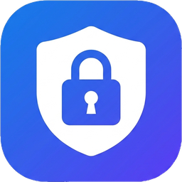

<div align="center">
  
  <h1>Account Vault</h1>
  <p><strong>Cross-Platform End-to-End Encrypted Password, OTP (TOTP/HOTP) & Passkey Vault</strong></p>

  <p>
    <a href="https://tauri.app/"></a>
    <a href="https://www.rust-lang.org/"></a>
    <a href="https://vuejs.org/"></a>
    <a href="https://www.sqlite.org/"></a>
    
    <a href="LICENSE"></a>
  </p>

  <p>
    <a href="README.md">简体中文</a> · <strong>English</strong>
  </p>
</div>

---

**Account Vault** is a modern, cross-platform credential manager spanning **Windows Desktop, Android Mobile (Android 16+), and a Chrome / Edge Browser Extension**. Built natively with **Rust + Tauri 2.0 + Vue 3 + SQLite3**, it encrypts every account record and local setting with **AES-256-GCM + Scrypt**, featuring **zero-knowledge WebDAV cloud sync**, **system-level Autofill & Passkey provider integration**, and an **isolated multi-account sandbox browser**.

---

## ✨ Key Features

### 1. 🗄️ Encrypted SQLite3 Local Storage Engine
- **Per-Record AES-256-GCM Encryption**: Powered by a local SQLite3 database (`vault.db` in `WAL` mode). Every account record and sensitive app setting (WebDAV credentials, browser bridge pairing token, biometric blobs) is encrypted with a unique random 12-byte nonce; the master password is never stored on disk.
- **Hardware-Backed Key Protection**: Integrates **Win32 DPAPI (`CryptProtectData`)** on Windows and **Android Keystore (`AES/GCM/NoPadding`)** on Android.
- **Online Snapshots & Rollback**: Uses `rusqlite::backup` to automatically create encrypted database snapshots (`backups/*.db`) before destructive operations, enabling one-click rollback.
- **Persistent Website Favicon Cache**: Caches domain favicons in the `favicon_cache` table so accounts sharing the same domain reuse a single cached icon with zero offline or startup flicker.

### 2. 🧭 Liquid Glass Tri-Tab Workspace (OTP · Passwords · PassKey)
- **Liquid Glass Bottom Capsule Navigation**: Smooth spring-animated bottom capsule switching between **OTP**, **Passwords**, and **PassKey** views, with customizable default startup tab (defaults to **OTP**) and mobile pull-to-refresh.
- **OTP Authenticator (TOTP + HOTP)**:
  - Full support for **RFC 6238 (TOTP)** time-based 30s codes and **RFC 4226 (HOTP)** counter-based codes (with one-click `+1` counter increment persistence);
  - Top-bar **QR Scanner** supporting live camera scanning, image upload, and `Ctrl+V` screenshot paste for `otpauth://totp/` and `otpauth://hotp/` URIs.
- **PassKey (WebAuthn / FIDO2 ES256)**:
  - Generates **ECDSA P-256 (ES256)** keypairs, CBOR-encoded `attestationObject`, and ASN.1 DER assertion signatures;
  - Passkeys sync seamlessly across devices inside encrypted account records via SQLite3 and WebDAV.

### 3. 🧩 Chrome / Edge Browser Extension (Manifest V3 Dual-Mode)
Located in [`browser-extension/`](browser-extension), the extension supports two freely switchable connection modes:
- **Mode 1: Local Desktop Bridge (`127.0.0.1:47291`)**:
  - Pairs with the desktop app using a random 256-bit Bearer Token, reuses the desktop unlock state (including Windows Hello), and blocks web `Origin` headers to prevent CSRF / DNS rebinding.
- **Mode 2: Direct WebDAV Cloud Connect (Standalone Browser Mode)**:
  - Runs independently without the desktop app using a byte-compatible pure-JS `Scrypt (N=32768, r=8, p=1) + AES-256-GCM` crypto engine and `Smart Merge`;
  - Holds the unlocked session strictly in memory (`chrome.storage.session`), with automatic `ETag / HEAD` change detection and periodic background sync.
- **In-Page Autofill, Floating 2FA Mini-Window & Passkey Interception**:
  - Injects the AccountVault logo badge on login fields, detects single-input and 6-box split 2FA inputs, and pops up a floating **2FA Mini-Window** across matching domains and subdomains;
  - Proxies `navigator.credentials.create()` / `get()` with a user-selectable **Standalone Popup Window** or **Closed Shadow DOM Overlay Card**, falling back transparently to native Windows Hello when unmatched.

### 4. 📱 Android 16 System Autofill & Credential Provider
- **System Passkey & Password Provider (`CredentialProviderService`)**: Registers with Android's system Credential Manager (`minSdk = 36`) to create and sign in with Passkeys and passwords across third-party apps and browsers.
- **System Autofill Service (`AutofillService` + `InlinePresentation`)**: Supports both Android 11+ keyboard inline suggestion chips and dropdown menus, including `<compatibility-package>` declarations for major mobile browsers.

### 5. 🔄 Multi-Manager Import & 🌐 Isolated Sandbox Browser
- **One-Click Migration**: Imports CSV / JSON exports from **Chrome, Edge, Firefox, Safari, Bitwarden, 1Password, and KeePass**, as well as encrypted `.avault` / `.gvault` archives.
- **Isolated Multi-Account Browser**: Assigns an independent WebView2 / Android WebView storage profile and optional proxy to each account, automatically skipping registration forms during login autofill.

---

## 🔐 Security & Cryptography Specifications

| Component | Algorithm / Standard | Details |
| :--- | :--- | :--- |
| **Master Key Derivation (KDF)** | `Scrypt` (`N=32768, r=8, p=1, dkLen=32`) | 16-byte random salt per vault |
| **Account Record Encryption** | `AES-256-GCM` (`AAD="AccountVault:Record:1"`) | Unique 12-byte random nonce per SQLite row |
| **Local Settings Encryption** | `AES-256-GCM` + `Win32 DPAPI` / `Android Keystore` | Encrypts WebDAV credentials & bridge tokens in `app_settings` |
| **WebDAV Cloud Envelope** | `AES-256-GCM` (`AAD="AccountVault:1"`) | Zero-knowledge encrypted blob with `ETag` + timestamp Smart Merge |
| **One-Time Passwords (OTP)** | `RFC 6238 (TOTP)` & `RFC 4226 (HOTP)` | `HMAC-SHA1` 6-digit dynamic codes |
| **Passkeys** | `WebAuthn Level 2` / `FIDO2` (`ES256` / `P-256`) | CBOR `attestationObject` + `COSE_Key` + `ASN.1 DER` signatures |

---

## 📖 Setup & Usage Guide

### 1. Browser Extension Setup (Chrome / Edge)
1. Open `chrome://extensions` or `edge://extensions` and enable **Developer mode**.
2. Click **Load unpacked** and select [`browser-extension`](browser-extension) (or drag and drop `AccountVault-Browser-Extension.crx`).
3. Click the `⚙` icon in the extension popup to choose a connection mode:
   - **Local Desktop Bridge**: Copy the pairing token from Desktop **Settings → Security → Chrome / Edge Extension** and paste it into the extension settings.
   - **WebDAV Cloud Direct**: Enter your WebDAV URL, username, and app password, then unlock directly with your master password.

### 2. Android System Autofill & Passkey Setup
1. Install the APK and unlock AccountVault once.
2. Go to **Settings → Security → Enable in System Settings** (or Android **Settings → Passwords, passkeys & autofill**) and select **AccountVault** as your preferred provider.
3. **OEM ROM Notes**:
   - **Xiaomi HyperOS / MIUI**: Disable **Secure Keyboard** in system input settings and turn off the built-in Xiaomi Password Vault autofill toggle so the system keyboard does not block third-party autofill services.
   - **Chrome on Android (Android 14+)**: In Chrome **Settings → Autofill Services**, select **Autofill using another service** and restart Chrome.

### 3. Local Database Locations
- **Windows**: `%LOCALAPPDATA%\AccountVault\vault.db` (snapshots in `backups\*.db`)
- **Android**: `/data/data/com.ifnor.accountvault/files/vault.db` (snapshots in `backups/*.db`)

---

## 📂 Project Structure

```text
AccountVault/
├── browser-extension/          # Chrome / Edge Browser Extension (Manifest V3)
│   ├── manifest.json           # Extension manifest
│   ├── background.js           # Dual-mode service worker (Local Bridge + WebDAV Direct)
│   ├── crypto_vault.js         # Pure-JS Scrypt + AES-256-GCM + TOTP/HOTP engine
│   ├── content.js              # Autofill badge, 2FA mini-window & Shadow DOM modal
│   ├── webauthn_inject.js      # WebAuthn / Passkey (ES256 + CBOR) main-world proxy
│   ├── passkey_prompt.*        # Standalone popup window for Passkey prompts
│   └── popup.*                 # Extension popup UI & settings
├── src/                        # Vue 3 + TypeScript frontend
│   ├── App.vue                 # Main workspace (OTP / Passwords / PassKey)
│   └── utils/importParsers.ts  # CSV / JSON parsers for browsers & password managers
├── src-tauri/                  # Rust + Tauri 2.0 backend & mobile project
│   ├── src/
│   │   ├── vault.rs            # SQLite3 + AES-256-GCM + DPAPI storage, backups & favicon cache
│   │   ├── totp.rs             # RFC 6238 (TOTP) & RFC 4226 (HOTP) implementation
│   │   ├── webdav.rs           # WebDAV E2EE sync & Smart Merge
│   │   ├── browser_bridge.rs   # Local 127.0.0.1 HTTP bridge for browser extension
│   │   ├── hello.rs            # Windows Hello / biometric hardware unlock
│   │   ├── backups.rs          # Local SQLite snapshot management
│   │   └── lib.rs              # Tauri commands, isolated browser & Android JNI bridge
│   └── gen/android/            # Android native project (AutofillService & CredentialProviderService)
└── .github/workflows/          # GitHub Actions CI/CD release pipeline
```

---

## 🛠️ Development & Build

### 1. Prerequisites
- **Node.js** `>= 20`
- **Rust** `stable` (2024 Edition)
- **Windows**: WebView2 Runtime, Visual Studio C++ Build Tools
- **Android** (optional): JDK 21, Android SDK (`platforms;android-36`, `build-tools;36.0.0`), Android NDK `r26d`

### 2. Development & Unit Tests
```powershell
# Install frontend dependencies
npm install

# Run desktop app in development mode
npm run tauri dev

# Run Rust unit tests (Crypto, SQLite CRUD, TOTP/HOTP, Smart Merge)
cd src-tauri
cargo test --lib
```

### 3. Production Packaging
```powershell
# Build Windows desktop app (portable .exe + NSIS installer)
npm run tauri build

# Build Android mobile app (arm64-v8a release APK)
npx tauri android build --apk -t aarch64
```

---

## 📄 License

Released under the [MIT License](LICENSE).
